# Plan to Correct & Upgrade Embraer E2 Honeywell NG FMS Pages, Preparation Flow & Flight Phases

Based on the two official reference documents provided:
1. **Guia Rápido: Preenchimento do FMS Embraer E195** (LATAM Training Guide, Pages 1–26)
2. **Honeywell NG FMS for the Embraer E-Jet E2 (E190/E195-E2) Pilot's Guide — Section 4: Operational Example** (REV 0 May 2024, Pages 4-1 to 4-56)

This document details every discrepancy between our initial v1 prototype and the real aircraft FMS, followed by a step-by-step atomic Git commit plan (`v1.1` through `v2.0`) to make the simulator 100% faithful to the real Embraer E2 Honeywell NG FMS.

---

## 1. Master Preflight Preparation Flow (Figure 4-4 & Guia Rápido)

In the real Honeywell NG FMS, the pilot is guided through the entire ground initialization sequence primarily using **LSK `6R` (Lower-Right Line Select Key)** and the **`NEXT`** key:

```mermaid
flowchart TD
    PWR["AVIONICS POWER\nRADIO 1/1"] -->|"Any FMS Key (NAV, PERF, FPL, RTE, PROG)\nor NAV -> NEXT -> 2L"| IDENT["NAV IDENT 1/1\nVerify Active NDB Dates"]
    IDENT -->|"If Position Invalid: 6R (POS INIT>)"| POS["POSITION INIT 1/1\n1R/2R/3R LOAD> -> 6R (RTE>)"]
    IDENT -->|"Position Valid: 6R (RTE>)"| RTE1["ACT RTE 1/2\n1L Origin, 1R Dest, 2R Altn, 5R Flight ID"]
    POS --> RTE1
    RTE1 -->|" becomes MOD RTE 1/3\nPush 6R (ACTIVATE>)"| ACTRTE1["ACT RTE 1/3\nPush 6R (DEPARTURE>)"]
    ACTRTE1 --> DEP["<ORIGIN> DEPARTURE 1/1\n1R RUNWAY> -> Select Rwy\n2R SID> -> Select SID & Trans\n6R APPLY>"]
    DEP --> RTE2["MOD RTE 2/3\nLeft LSK = VIA (Airways)\nRight LSK = TO (Fixes)\n6R ACTIVATE> -> Push NEXT"]
    RTE2 --> ALTN["ALTN RTE 3/3 (or 4/4)\nEnter Alternate Route\n6R ACTIVATE> -> 6R PERF INIT>"]
    ALTN --> PERF1["PERFORMANCE INIT-KG 1/3\n2L Fuel Reserve (30 MIN), 3L TO/LDG Fuel\nPush NEXT"]
    PERF1 --> PERF2["PERFORMANCE INIT-KG 2/3\n1L CRZ ALT, 2L CRZ WINDS, 2R ISA DEV\n3R ZFW (KG), 5L TO CG (%)\nPush NEXT"]
    PERF2 --> PERF3["PERFORMANCE INIT 3/3\n4L Cost Index (CI)\nPush 6R (TO DATASET>)"]
    PERF3 --> TODS["T/O DATASET MENU 1/1\n1L-3L TO-1/2/3, 4L TO TEMP\n1R ATTCS, 2R ECS, 3R A/I, 4R FLEX, 5R FLEX TEMP\n5L ■ENTER -> 6R (FMS TAKEOFF>)"]
    TODS --> TOINIT1["TAKEOFF INIT 1/2\n3R Surface Wind (computes arrows at 4R)\n4L RWY Condition (DRY/WET/CNTMNTD)\nPush NEXT"]
    TOINIT1 --> TOINIT2["TAKEOFF INIT 2/2\n1R OR> -> TAKEOFF FLAPS 1/1 (1L-4L Flap 1-4)\nVerify Flap, CG, Temp, Flex\nPush 6R (TAKEOFF>)"]
    TOINIT2 --> TOSPD["TAKEOFF 1/1 (Speeds)\n1L V1, 2L VR, 3L V2, 4L VFS\nAuto-computes PITCH TRIM & TO PITCH\nPush 6R (DEP LIM>)"]
    TOSPD --> DEPLIM["DEPARTURE LIMIT 1/1\n1L Speed Limit (V2+10), 2L AFE Limit\n3L VNAV CAP AFE, 4L EO Bank Lim\nPush 6R (FLT PLAN>)"]
    DEPLIM --> FPL["ACTIVE FLT PLAN 1/X\nReady for Takeoff"]
```

---

## 2. Audit of Issues in Current Prototype vs. Actual Aircraft FMS

### 2.1 Hardware Bezel, Keypad & Rotary Knob (`McduKeypad.tsx` & `McduBezel.tsx`)
- **Current Issue**: Function keys are in a single 9-button bar (`RTE..NEXT`), numeric keys are on the left, alpha keys on the right, and there is no **Rotary Knob**.
- **Correction (Per Guia Rápido pp. 2–26)**:
  - **2-Row Function Key Matrix**:
    - Row 1: `PERF`, `NAV`, `PREV`, `FPL`, `PROG`, `RTE`, `CB`, and `BRT/DIM` rocker.
    - Row 2: `MENU`, `DLK`, `NEXT`, `[blank]`, `TRS`, `RADIO`.
  - **Lower Keypad Layout**:
    - **Left**: `A–Z` in 6-column / 5-column rows (`A..F`, `G..L`, `M..R`, `S..W`, `X Y Z DEL CLR`).
    - **Right Top**: Interactive **Concentric Rotary Knob** (click/scroll/buttons `-` / `+` to increment/decrement `TO TEMP` and `FLEX TEMP` on `T/O DATASET MENU` just like in the cockpit!).
    - **Right Bottom**: Round `3×4` numeric keypad (`1 2 3 +/-`, `4 5 6 /`, `7 8 9`, `SP 0 .`).

### 2.2 Page-by-Page Screen Layout & LSK Mapping Corrections

| Page | Issues in v1 Prototype | Exact Honeywell NG FMS Layout (Per PDF 1 & PDF 2) |
| :--- | :--- | :--- |
| **`NAV INDEX 1/2 & 2/2`** | `4L` had `<PATTERNS`; `6R` had `INDEX 2/2>` instead of `<DEPARTURE` / `ARRIVAL>`. | **1/2**: `1L <DATALINK`, `1R ATC>`, `2L <WPT LIST`, `2R FIX INFO>`, `3L <FPL LIST`, `3R SEC FPL MENU>`, `4L <CROSS PTS`, `4R FLT SUM>`, `5L <PATTERNS`, `5R HOLD>`, `6L <DEPARTURE`, `6R ARRIVAL>`. **2/2**: `1L <POS SENSORS`, `1R POS INIT>`, `2L <NAV IDENT`, `2R CONVERSION>`, `3L <DATA LOAD`, `3R MAINTENANCE>`, `4L <CLOSEST APT`. Use `NEXT`/`PREV` key to flip pages. |
| **`NAV IDENT 1/1`** | Showed `MODEL E195-E2` / `ENGINES PW1900G` on `1L/2L` and always showed `POS INIT>` on `6R`. | `1L`: `DATE` (`19MAY26`), `1R`: `ACTIVE NDB` (`20APR 18MAY/23`). `2L`: `UTC` (`0041z`), `2R`: `NON-ACTIVE NDB` (`26JAN 23FEB/23>`). `3L`: `SW` (`NG 1.0`), `3R`: `NDB V2.08 23M` (`H3652304001` / `DS31908001`). `5L`: `<LDG IDENT`, `6L`: `<MAINTENANCE`. `6R`: Displays **`RTE>`** normally, or **`POS INIT>` in Reverse Video** ONLY when FMS position is invalid. |
| **`POSITION INIT 1/1`** | Had `SET POS` boxes on `4L`. | `1L`: `LAST POS` (`N33°25.9 W112°01.4`) / `1R`: `LOAD>`. `2L`: `<APT> REF WPT` (`N33°26.1 W112°00.7`) / `2R`: `LOAD>`. `3L`: `GPS 1 POS` (shows `(LOADED)` in header when loaded) / `3R`: `LOAD>`. `6L`: `<POS SENSORS` / `6R`: `RTE>`. |
| **`ACT RTE 1/2` & `MOD RTE 1/3`** | Had `ALTN` always visible, `FLIGHT ID` at `3R`, `<PERF INIT` at `6L`, and `NEXT PAGE>` at `6R`. | **Before DEST entered (`ACT RTE 1/2`)**: `1L ORIGIN` (`SBGR`), `1R DEST` (`□□□□□`), `2L RUNWAY`, `3L <DLK FPL / FPL REQST`, `3R CO ROUTE` (`--------`), `4R FPL REPORT`, `5L <OFFSET`, `5R FLIGHT ID` (`--------`), `6L <FPL LIST`, `6R DEPARTURE>`. **After DEST entered (`MOD RTE 1/3`)**: `2R ALTN DEST` (`-----` -> `SBGO`), `3R CO ROUTE` (`SBGR-SBCF`), `4L <SEND`, `5R FLIGHT ID` (`TAM3000`), `6L <CANCEL`, `6R ACTIVATE>`. **After `6R ACTIVATE>` (`ACT RTE 1/3`)**: `6L <FPL LIST`, `6R DEPARTURE>`. |
| **`DEPARTURE 1/1`, `RUNWAYS 1/1`, `SIDs`, `SID TRANS`** | Was a single static page (`*09L`, `*VEXIM1A`). | Full 4-screen interactive flow: 1. **`<APT> DEPARTURE 1/1`**: Columns `ACTIVE` vs `SELECTED`. `1R RUNWAY>`, `2R SID>`, `6R TAKEOFF>` (or `6L <CLEAR SEL` / `6R APPLY>` when selected). 2. **`<APT> RUNWAYS 1/1`**: Select runway (`<09L`, `<09R`, `<10L`, `<10R`, `<08`, etc.) -> auto-opens `SIDs`. 3. **`<APT> SIDs 1/1`**: Select SID (`<OMNI`, `<SILOW4`, `<VEXIM1A`) -> opens `SID TRANS` (if transitions exist) or returns to `DEPARTURE 1/1`. 4. Pushing `6R APPLY>` inserts procedure into **`MOD RTE 2/3`**. |
| **`MOD / ACT RTE 2/3` & `ALTN RTE 3/3`** | Used dot-string `GUP.J102.ALS` on `RTE 2/3` and had no `ALTN RTE 3/3` page. | **On `RTE 2/3`**: Left LSKs (`1L..5L`) are **`VIA` (Airways)**; Right LSKs (`1R..5R`) are **`TO` (Waypoints)**. Entering an airway at `2L` (e.g. `J44` or `UZ1`) displays `THEN □□□□□` at `2R` above `>>DISCONTINUITY<<`. Entering the exit fix at `2R` (e.g. `ALS`) expands the airway and creates `MOD RTE 2/3` (`6L <CANCEL`, `6R ACTIVATE>`). When active, `6L` is `<ARRIVAL`. **On `ALTN RTE 3/3` (via `NEXT`)**: Displays `VIA / TO` to `ALTN DEST` (`SBGO` / `KDLH`). Pushing `6R ACTIVATE>` activates the alternate route, and **`6R` becomes `PERF INIT>`**! |
| **`PERFORMANCE INIT 1/3, 2/3, 3/3`** | Wrong LSK positions on `2/3` (`PASS` was at `1R`, `ZFW` at `2R`, `CG` at `4L`, weights in thousands instead of KG) and `3/3` lacked `COST INDEX` and `TO DATASET>`. | **`PERF INIT-KG 1/3`**: `1L TAIL #`, `1R PERF FACTOR (1.00)`, `2L FUEL RESERVE (30 MIN)`, `2R OR>`, `3L TO/LDG FUEL (142/105)`, `4L ALTN FUEL (-----)`, `5R SEND REQST>`. **`PERF INIT-KG 2/3`**: `1L CRZ ALT (□□□□□)`, `1R STEP INC (0)`, `2L CRZ WINDS (000T/0)`, `2R ISA DEV (+0°C)`, `3L PASS (114)`, `3R ZFW (□□□□□ -> 40000)`, `4R (GAUGE) FUEL ((7600) 7600)`, `5L TO CG (□□.□% -> 29.0%)`, `5R GROSS WT (47600)`. **`PERF INIT 3/3`**: `1L CLIMB SPEED ECON(252/.65M)` / `1R OR>`, `2L CRUISE SPEED ECON(242/.65M)` / `2R OR>` (opens `CRUISE MODES 1/1`), `3L DESCENT SPEED ECON(247/.65M)` / `3R OR>`, `4L COST INDEX (1)`, `6R TO DATASET>`. |
| **`T/O DATASET MENU 1/1`** | Missing entirely in v1. | Accessed via `6R (TO DATASET>)` on `PERF INIT 3/3` or `TRS` key: `1L *TO-1 (19K8)`, `2L *TO-2 (17K9)`, `3L *TO-3 (17K1)`, `4L TO TEMP (20 C)`, `5L ■ENTER` (reverse video), `6L <TRS`. `1R ATTCS (OFF ON<-)`, `2R REF ECS (OFF ON<-)`, `3R REF A/I (OFF ENG ALL<-)`, `4R FLEX T/O (OFF ON<-)`, `5R FLEX TEMP (C 25 C)`, `6R FMS TAKEOFF>`. |
| **`TAKEOFF INIT 1/2 & 2/2` + `TAKEOFF FLAPS 1/1`** | Combined into 1 page and lacked `TAKEOFF INIT 2/2` and `TAKEOFF FLAPS 1/1`. | **`TAKEOFF INIT 1/2`**: `1L RWY HDG (095°)`, `1R GROSS WT (47600KG)`, `2L P ALT/B SET (2450/1013)`, `2R ELEV (2450)`, `3L RWY SLOPE (0.0%)`, `3R WIND (□□□°/□□ -> 200°/05)`, `4L RWY CONDITION (<-DRY/WET/CNTMNTD)`, `4R WIND (↑1 <-5 components)`, `5R SEND REQST>`, `6L <PERF INIT`. **`TAKEOFF INIT 2/2` (via `NEXT`)**: `1L FLAPS (FLAP 2)`, `1R OR>` (opens **`TAKEOFF FLAPS 1/1`** with `1L..4L <FLAP-1..4` and `1R RETURN>`), `2L TO CG (29.0%)`, `2R TO TEMP (+20°C)`, `3L/3R MODE<-FLEX TO-->TEMP (ON / +25°C)`, `4L/4R MODE<-DATASET->ATTCS (TO-3 / ON)`, `6L <TO DATASET`, `6R TAKEOFF>`. |
| **`TAKEOFF 1/1` (Speeds) & `DEPARTURE LIMIT 1/1`** | Was titled `TAKEOFF VSPEEDS 2/2` and lacked `DEPARTURE LIMIT 1/1`. | **`TAKEOFF 1/1`**: `1L V1 (--- -> 135)`, `2L VR (--- -> 140)`, `3L V2 (--- -> 142)`, `4L VFS (--- -> 195)`, `2R FLAPS (2)`, `3R PITCH TRIM (3.4UP)`, `4R TO PITCH (8.2)`, `5L <LANDING`, `5R CLIMB>`, `6L <TO INIT`, `6R DEP LIM>`. **`DEPARTURE LIMIT 1/1`**: `1L SPEED LIMIT (152 / V2+10)`, `2L AFE LIMIT (3000)`, `3L VNAV CAP AFE (1000)`, `4L/4R VNAV CAP<-EO->BANK LIM (1000 / 15°)`, `6L <TAKEOFF`, `6R FLT PLAN>`. |
| **Flight-Phase Dynamic Presentations (`FPL`, `ARRIVAL`, `LANDING INIT`, `ROAAS`, `LANDING`)** | Static `ACTIVE FLT PLAN` & single `LANDING` page. | Add **Flight Phase Selector** (`PREFLIGHT`, `TAKEOFF`, `CLIMB`, `CRUISE`, `DESCENT`, `APPROACH`, `GO_AROUND`) that dynamically adapts `ACTIVE FLT PLAN` headers/prompts (`CLB SPD` + `<DEPARTURE / PERF PLAN>` -> `<CLB DIR / PERF PLAN>` -> `<DES NOW / ARRIVAL>` -> `LANDING>`), plus the full **`ARRIVAL` (`STAR` / `APPROACH` / `TRANS` / `APPLY>`)** and **`LANDING INIT 1/1` -> `ROAAS` -> `CONF INIT>` -> `LANDING 1/1` (`COMP` reverse-video speeds)** flow! |

---

## 3. Step-by-Step Implementation & Git Commit Plan (`v1.1` – `v1.7`)

Each step below will be verified with Vitest unit tests and `npm run build` before committing and tagging so you can roll back to any checkpoint at any time.

### Step 11 (`v1.1-mcdu-hardware`): Authentic MC-860 2-Row Function Matrix, Alpha-Left / Numeric-Right Keypad & Rotary Knob
- Update `McduKeypad.tsx` and `McduBezel.tsx` to match the exact physical layout in the LATAM E195/E2 Guia Rápido:
  - 2-row Function Key bar (`PERF`, `NAV`, `PREV`, `FPL`, `PROG`, `RTE`, `CB`, `BRT/DIM` on row 1; `MENU`, `DLK`, `NEXT`, `[blank]`, `TRS`, `RADIO` on row 2).
  - Left 6-column / 5-column `A–Z` + `DEL` + `CLR` matrix; Right concentric **Rotary Knob** (supports mouse wheel & `-`/`+` click to tune `TO TEMP` / `FLEX TEMP`) above the round `3×4` numeric keypad.

### Step 12 (`v1.2-nav-ident-pos`): Correct `NAV INDEX 1/2–2/2`, `NAV IDENT 1/1`, and `POSITION INIT 1/1`
- Update `NAV INDEX 1/2` (`<CROSS PTS`, `FLT SUM>`, `<PATTERNS`, `HOLD>`, `<DEPARTURE`, `ARRIVAL>`) and `2/2` (`<POS SENSORS`, `POS INIT>`, `<NAV IDENT`, `CONVERSION>`, `<DATA LOAD`, `MAINTENANCE>`, `<CLOSEST APT`).
- Update `NAV IDENT 1/1` (`DATE`, `UTC`, `SW NG 1.0`, `ACTIVE NDB`, `NON-ACTIVE NDB>`, `NDB V2.08`, `<LDG IDENT`, `<MAINTENANCE`, and `RTE>` vs. reverse-video `POS INIT>`).
- Update `POSITION INIT 1/1` (`LAST POS`, `REF WPT`, `GPS 1 POS (LOADED)`, `LOAD>`, `<POS SENSORS`, `RTE>`).

### Step 13 (`v1.3-rte-departure-flow`): Authentic `ACT/MOD RTE 1–3`, Multi-Screen `DEPARTURE` (`RUNWAYS`, `SIDs`, `SID TRANS`, `APPLY>`) & `ALTN RTE`
- Implement `ACT RTE 1/2` -> `MOD RTE 1/3` (`1L ORIGIN`, `1R DEST`, `2R ALTN DEST`, `3R CO ROUTE`, `5R FLIGHT ID`, `6L <CANCEL`, `6R ACTIVATE>`) -> `ACT RTE 1/3` (`6R DEPARTURE>`).
- Implement the interactive `DEPARTURE 1/1` (`ACTIVE` vs `SELECTED`, `1R RUNWAY>`, `2R SID>`, `6L <CLEAR SEL`, `6R APPLY>`), `RUNWAYS 1/1`, `SIDs 1/1`, and `SID TRANS 1/1` sub-pages.
- Implement `RTE 2/3` separate Left-LSK `VIA` (Airway) + Right-LSK `TO` (`□□□□□` Fix) entry with `>>DISCONTINUITY<<` closure, and `ALTN RTE 3/3` with `6R ACTIVATE>` -> `6R PERF INIT>`.

### Step 14 (`v1.4-perf-todataset`): Authentic `PERFORMANCE INIT-KG 1/3–3/3`, `CRUISE MODES 1/1`, and `T/O DATASET MENU 1/1`
- Update `PERFORMANCE INIT-KG 1/3` (`2L FUEL RESERVE`, `2R OR>`, `3L TO/LDG FUEL`, `4L ALTN FUEL`, `5R SEND REQST>`).
- Update `PERFORMANCE INIT-KG 2/3` (`1L CRZ ALT`, `1R STEP INC`, `2L CRZ WINDS`, `2R ISA DEV`, `3L PASS`, `3R ZFW` in KG, `4R (GAUGE) FUEL`, `5L TO CG %`, `5R GROSS WT` in KG).
- Update `PERFORMANCE INIT 3/3` (`1L..3L ECON` speeds with `1R..3R OR>`, `4L COST INDEX`, `6R TO DATASET>`) and `CRUISE MODES 1/1`.
- Implement `T/O DATASET MENU 1/1` (`1L..3L TO-1/2/3`, `4L TO TEMP`, `5L ■ENTER`, `1R ATTCS`, `2R REF ECS`, `3R REF A/I`, `4R FLEX T/O`, `5R FLEX TEMP` with Rotary Knob support, and `6R FMS TAKEOFF>`).

### Step 15 (`v1.5-takeoff-deplim`): Authentic `TAKEOFF INIT 1/2–2/2`, `TAKEOFF FLAPS 1/1`, `TAKEOFF 1/1` (Speeds) & `DEPARTURE LIMIT 1/1`
- Implement `TAKEOFF INIT 1/2` (`1L RWY HDG`, `1R GROSS WT`, `2L P ALT/B SET`, `2R ELEV`, `3L RWY SLOPE`, `3R WIND`, `4L RWY CONDITION <-DRY/WET/CNTMNTD`, `4R` computed headwind/crosswind arrows, `6L <PERF INIT`).
- Implement `TAKEOFF INIT 2/2` (`1L FLAPS`, `1R OR>` -> `TAKEOFF FLAPS 1/1`, `2L TO CG`, `2R TO TEMP`, `3L/3R FLEX TO`, `4L/4R DATASET/ATTCS`, `6L <TO DATASET`, `6R TAKEOFF>`).
- Implement `TAKEOFF 1/1` (`1L..4L V1/VR/V2/VFS` starting at `---`, `2R FLAPS`, `3R PITCH TRIM`, `4R TO PITCH`, `5L <LANDING`, `5R CLIMB>`, `6L <TO INIT`, `6R DEP LIM>`).
- Implement `DEPARTURE LIMIT 1/1` (`1L SPEED LIMIT`, `2L AFE LIMIT`, `3L VNAV CAP AFE`, `4L/4R VNAV CAP<-EO->BANK LIM`, `6L <TAKEOFF`, `6R FLT PLAN>`).

### Step 16 (`v1.6-flight-phases-arrival-landing`): Flight-Phase Switcher, `ACTIVE FLT PLAN` Phase Views, `ARRIVAL` Flow & `LANDING INIT / ROAAS / LANDING`
- Add Flight Phase state (`PREFLIGHT`, `TAKEOFF`, `CLIMB`, `CRUISE`, `DESCENT`, `APPROACH`, `MISSED_APPROACH`) so `ACTIVE FLT PLAN` and `ACT RTE` dynamically adapt their headers, bearing/distance lines, and `6L/6R` prompts (`<DEPARTURE / PERF PLAN>`, `<CLB DIR / PERF PLAN>`, `<DES NOW / ARRIVAL>`, `LANDING>`).
- Implement the full `ARRIVAL 1/1` (`RUNWAY>`, `APPROACH>`, `STAR>`, `STAR TRANS`, `APPROACH TRANS`, `<CLEAR SEL`, `APPLY>`) flow.
- Implement `LANDING INIT 1/1` -> `ROAAS 1/1` -> `CONF INIT>` -> `LANDING 1/1` (with `COMP` reverse-video V-speeds that turn green upon confirmation) + `MISSED APPROACH` & `ALTERNATE FPL` pages.

### Step 17 (`v1.7-guided-flow-v2`): Update Guided Preflight Trainer (LATAM E195 & Honeywell E2 Flows) & Test Suite
- Update `GuidedPreflightPanel.tsx` so trainees can follow the exact 14-step LATAM / Honeywell E2 preflight sequence from `NAV` -> `NAV IDENT` -> `ACT RTE` -> `DEPARTURE` (`RWY` + `SID` + `APPLY`) -> `MOD RTE 2/3` -> `ALTN RTE 3/3` -> `PERF INIT 1/3–3/3` -> `T/O DATASET` -> `TAKEOFF INIT 1/2–2/2` (`FLAPS`) -> `TAKEOFF` (`V1..VFS`) -> `DEPARTURE LIMIT` -> `ACTIVE FLT PLAN`.
- Update and expand Vitest unit & E2E workflow tests.
