# Step-by-Step Implementation & Git Checkpoint Plan: Embraer E2 Honeywell NG FMS MCDU Simulator

> [!IMPORTANT]
> Every step below ends with a **Verification Gate** (`npm run typecheck`, `npm run test`, `npm run build`) followed by an **Atomic Git Commit & Tag**. If anything goes wrong during a step, you can immediately roll back to the previous verified checkpoint using `git reset --hard <tag>`.

---

## Git Workflow & Rollback Strategy

```mermaid
flowchart LR
    C0["v0.0-docs\nBaseline Docs"] --> C1["v0.1-scaffold\nVite + TS + Tailwind"]
    C1 --> C2["v0.2-models-navdb\nTypes & AIRAC DB"]
    C2 --> C3["v0.3-parsers\nScratchpad Syntax Engine"]
    C3 --> C4["v0.4-store\nZustand FMS Engine"]
    C4 --> C5["v0.5-display-bezel\n14x24 LCD & MC-860 Shell"]
    C5 --> C6["v0.6-init-pages\nRADIO, NAV IDENT, POS INIT"]
    C6 --> C7["v0.7-rte-fpl-pages\nACT RTE & ACTIVE FLT PLAN"]
    C7 --> C8["v0.8-perf-to-pages\nPERF INIT, TAKEOFF, VSPEEDS"]
    C8 --> C9["v0.9-nav-prog-pages\nNAV INDEX, PROGRESS, Subpages"]
    C9 --> C10["v1.0-training-qa\nGuided Mode, Faults & E2E"]
```



### Quick Rollback Commands
- **Discard uncommitted changes in the current step**:
  ```powershell
  git reset --hard HEAD
  git clean -fd
  ```
- **Jump back to any specific milestone tag**:
  ```powershell
  git reset --hard <tag-name>   # e.g., git reset --hard v0.5-display-bezel
  ```

---

## Step 0: Git Repository Initialization & Baseline Docs
**Goal**: Initialize the local Git repository and snapshot the two original specification documents before adding any code.

- **Actions**:
  1. Run `git init` and set the default branch to `main`.
  2. Create `.gitignore` (`node_modules/`, `dist/`, `coverage/`, `.env*`).
  3. Stage [Project Plan (v3)](file:///d:/leandro/DEV/remote-repos/e2_fms/Project%20Plan_%20Embraer%20E2%20Honeywell%20NG%20FMS%20MCDU%20Interactive%20Training%20Simulator%20(v3).md) and [Scratchpad Specification Guide](file:///d:/leandro/DEV/remote-repos/e2_fms/Honeywell%20NG%20FMS%20MCDU%20Scratchpad%20Syntax%20&%20Data%20Entry%20Specification%20Guide.md).
- **Commit & Tag**:
  - **Commit**: `chore: initialize repository with FMS project plan and scratchpad specification docs`
  - **Tag**: `v0.0-docs`

---

## Step 1: Project Scaffolding, Fonts & Audio Engine
**Goal**: Set up Vite + React + TypeScript + Tailwind CSS + Vitest + Web Audio API tactile feedback.

- **Files to Create**:
  - `package.json`, `tsconfig.json`, `vite.config.ts`, `index.html` (loading **B612 Mono** aviation font).
  - `src/index.css` (custom CRT/LCD glow utilities, reverse-video classes, and strict 24-character cell rules).
  - `src/audio/soundEngine.ts` (Web Audio API synthesizer for tactile MC-860 key click, error chime, and scratchpad alert beep—zero external audio file dependencies).
- **Verification Gate**:
  - `npm run build` succeeds with zero TypeScript errors.
- **Commit & Tag**:
  - **Commit**: `feat(scaffold): setup Vite React TS Tailwind environment, B612 aviation font, and Web Audio synthesizer`
  - **Tag**: `v0.1-scaffold`

---

## Step 2: Core FMS TypeScript Models & Static AIRAC Navigation Database (`navdb`)
**Goal**: Define all strongly-typed FMS state structures (with serializable `Record` types instead of `Map`) and build a realistic AIRAC navigation database.

- **Files to Create**:
  - `src/types/fms.ts`:
    - `FmsWeightData`, `FmsSpeedData`, `FmsWaypoint`, `FmsWaypointConstraint`, `FmsFlightPlan`, `FmsAtmosphericData` (using `Record<string, WaypointWindLayer[]>`), `FmsAltitudeData`.
    - Strict 14-line screen model (`ScreenPageData`: `line1` header, `lskRows` 1–6 each with `labelLine` + `dataLine`, and `line14` scratchpad).
  - `src/data/navdb.ts`:
    - Airports (`SBGR`, `SBRJ`, `SBGL`, `SBKP`, `SBSP`, `KJFK`, `KBOS`) with coordinates, elevation, transition altitudes, and runways (`09L`, `09R`, `27L`, `02R`, `15`, etc.) including runway heading, slope, and length.
    - Navaids & Waypoints (`VEXIM`, `BUSPA`, `BCO`, `CPN`, `PXR`, `DRK`, `BXK`, `GUP`, `ALS`, `TCS`, `PKE`).
    - Airways (`J102`, `J65`, `J4`, `UZ1`, `UW2`) and Company Routes (`GRUJSD01`, `GRUGIG01`).
  - `src/utils/geo.ts`:
    - Great-circle distance (NM), initial magnetic bearing, radial intersection (`&PBPB`), Place/Bearing/Distance (`&PBD`), and ETA/EFOB calculator.
- **Verification Gate**:
  - `npx vitest run src/utils/__tests__/geo.test.ts` (unit tests for distance, PBD, and radial intersections).
- **Commit & Tag**:
  - **Commit**: `feat(data): add core FMS TypeScript interfaces, geospatial math utilities, and static AIRAC navdb`
  - **Tag**: `v0.2-models-navdb`

---

## Step 3: Scratchpad Syntax Parser & Data Validation Engine
**Goal**: Implement the complete 22-row syntax matrix from the [Scratchpad Specification Guide](file:///d:/leandro/DEV/remote-repos/e2_fms/Honeywell%20NG%20FMS%20MCDU%20Scratchpad%20Syntax%20&%20Data%20Entry%20Specification%20Guide.md) as pure, unit-tested functions.

- **Files to Create**:
  - `src/engine/scratchpadParser.ts`:
    - Latitude (`Nddmm.mm`/`Sddmm.mm`), Longitude (`Edddmm.mm`/`Wdddmm.mm`), and combined Lat/Long (`N50W050` -> `N50°00.00 W050°00.00`).
    - Temporary waypoints (`&LLxx`, `&PBDxx`, `&PDxx`, `&PBPBxx`) with `RADIALS DO NOT INTERSECT` detection.
    - Airway strings (`start.airway.end`, `airway.end`, `start.awy1.awy2.end`) with `WAYPOINT NOT ON AIRWAY` validation.
    - Altitude / Flight Level 3-digit rule (`280` -> `FL280`, `008` -> `800FT`), certified ceiling check (`41,000 FT` -> `EXCEEDS CERT CEILING`), and VNAV constraints (`10000A`, `10000B`, `16000A17000B`).
    - CAS (`75–320 KTS`), Mach (`.30–.82`), Weights/ZFW (`30.0–55.0t` or `30000–55000`), Takeoff CG (`10.0–40.0% MAC` -> `CHECK TAKEOFF CG`), Wind (`ddd/ss`), OAT/ISA Dev, Hold course/turn, Lateral offset (`Ld.d`/`Rd.d`), QNH/QFE, and V-speed hierarchy ($V_1 \le V_R \le V_2 \le V_{FS} / 1.19$).
  - `src/engine/__tests__/scratchpadParser.test.ts`:
    - Comprehensive Vitest suite testing every valid shorthand, auto-format output, and error trigger in Section 2 of the specification guide.
- **Verification Gate**:
  - `npx vitest run src/engine/__tests__/scratchpadParser.test.ts` passes 100%.
- **Commit & Tag**:
  - **Commit**: `feat(parser): implement Honeywell NG FMS scratchpad syntax parser, auto-formatter, and validation suite`
  - **Tag**: `v0.3-parsers`

---

## Step 4: Unified Zustand FMS State Machine & Scratchpad Stack
**Goal**: Build the central FMS state store handling scratchpad buffer persistence across pages, `CLR`/`DEL` stack rules, priority alert queue, up-select/down-select mechanics, and `ACTIVE` vs. `MOD` flight plan state.

- **Files to Create**:
  - `src/store/useFmsStore.ts`:
    - **Scratchpad Engine**: 24-character limit, `DEL` key (`DELETE` mode + dash-suffix clear rule `N50W050-` + `DEL`), `CLR` dual-role logic (pop top alert message first; otherwise backspace 1 character), and priority message stack (`High` -> `Medium` -> `Low`, FILO within same priority).
    - **Page Router**: Active page ID, sub-page index (`currentPage / totalPages`), `PREV` / `NEXT` cycling, and power-up rule (`RADIO` default -> first FMS function key jumps to `NAV IDENT 1/1`).
    - **Aircraft & Flight Plan State**: Real-time recomputation of Gross Weight (`ZFW + FOB`), optimum altitude, V-speed reverse-video mismatch flags, and waypoint ETA/DTG/EFOB predictions.
  - `src/store/__tests__/useFmsStore.test.ts`:
    - Unit tests for `CLR`/`DEL` behavior, message priority stacking, and ZFW/FOB/GW reactivity.
- **Verification Gate**:
  - `npx vitest run` passes all parser, geo, and store tests.
- **Commit & Tag**:
  - **Commit**: `feat(store): implement unified Zustand FMS store, priority message queue, and CLR/DEL scratchpad stack`
  - **Tag**: `v0.4-store`

---

## Step 5: Hardware Visual Shell (MC-860 Bezel) & 14×24 Character-Cell LCD Renderer
**Goal**: Build the pixel-accurate Honeywell MC-860 hardware unit, strict 14×24 character grid display, LSK buttons, and physical/keyboard input bindings.

- **Files to Create**:
  - `src/components/mcdu/McduScreen.tsx`:
    - Strict 14-row × 24-column character matrix.
    - Supports per-cell color (`WHITE`, `CYAN`, `GREEN`, `YELLOW`, `MAGENTA`, `AMBER`), font size (`SMALL` for labels/predictions, `LARGE` for pilot entries/active data), `reverseVideo` highlight, and box prompts (`□`).
  - `src/components/mcdu/McduBezel.tsx` & `src/components/mcdu/McduKeypad.tsx`:
    - Authentic Embraer E2 Honeywell MC-860 bezel with 12 LSKs (`1L–6L`, `1R–6R`), function keys (`PERF`, `NAV`, `FPL`, `PROG`, `RTE`, `RADIO`, `DIR`, `PREV`, `NEXT`), full A–Z / 0–9 keypad, `+/-/`, `.`, `/`, `SP`, `DEL`, `CLR`, and `MSG` / `FAIL` annunciator LEDs.
    - Physical keyboard listener (type A–Z, 0–9, Backspace=`CLR`, Delete=`DEL`, PageUp=`PREV`, PageDown=`NEXT`, F1–F6=`1L–6L`, Shift+F1–F6=`1R–6R`).
- **Verification Gate**:
  - `npm run build` && `npx vitest run`.
- **Commit & Tag**:
  - **Commit**: `feat(ui): build Honeywell MC-860 hardware bezel, 14x24 character LCD renderer, and keyboard bindings`
  - **Tag**: `v0.5-display-bezel`

---

## Step 6: Power-Up & Initialization Pages (`RADIO`, `NAV IDENT`, `POSITION INIT`)
**Goal**: Implement the avionics power-up state and initial system verification pages.

- **Files to Create**:
  - `src/pages/RadioPage.tsx` (Default power-up screen; any FMS function key transitions to `NAV IDENT 1/1`).
  - `src/pages/NavIdentPage.tsx` (`MODEL E195-E2`, `ENGINES PW1900G`, `NAV DB AIRAC 2405`, `POS INIT>` at `6R` with reverse video when position is uninitialized).
  - `src/pages/PositionInitPage.tsx` (`LAST POS`, `REF WPT`, `GPS 1 POS` with `LOAD>` prompts at `1R–3R`, manual `SET POS` box prompts at `4L`, and `RTE>` prompt at `6R`).
- **Verification Gate**:
  - `npm run build` && unit test verifying power-up transition `RADIO` -> `NAV IDENT` -> `POS INIT` -> load GPS -> `RTE>`.
- **Commit & Tag**:
  - **Commit**: `feat(pages): implement RADIO, NAV IDENT 1/1, and POSITION INIT 1/1 pages`
  - **Tag**: `v0.6-init-pages`

---

## Step 7: Route & Flight Plan Pages (`ACT RTE 1/3–2/3` & `ACTIVE FLT PLAN`)
**Goal**: Implement route initialization, airway/company route loading, waypoint insertion/deletion, Direct-To (`DIR`), and VNAV constraint entry.

- **Files to Create**:
  - `src/pages/ActRtePage.tsx`:
    - `ACT RTE 1/3`: `ORIGIN`, `DEST`, `RUNWAY`, `ALTN`, `CO ROUTE` (e.g., `GRUJSD01` auto-populates `SBGR` -> `SBRJ` waypoints), `FLIGHT ID`, `<OFFSET`, `<PERF INIT`, `NEXT PAGE>`.
    - `ACT RTE 2/3`: `VIA / TO` airway and waypoint string expansion (`GUP.J102.ALS`, `J102.ALS`).
  - `src/pages/ActiveFltPlanPage.tsx`:
    - Multi-page `ACTIVE FLT PLAN 1/X` showing `FROM` (Yellow), `TO` (Magenta), `NEXT`/`DEST` (Green), ETA/DTG/Alt/EFOB (Small Cyan).
    - Supports up-selecting waypoints, temporary waypoints (`&LL01`, `&PBD01`), speed/altitude constraints (`210/10000A`, window constraints, irrational constraint reverse-video detection), and `DELETE` waypoint removal.
    - Supports `MOD FLT PLAN` header with `<ACTIVATE` / `CANCEL MOD>` confirmation when modified.
- **Verification Gate**:
  - `npm run build` && `npx vitest run`.
- **Commit & Tag**:
  - **Commit**: `feat(pages): implement ACT RTE 1/3-2/3 and ACTIVE FLT PLAN with MOD confirmation and constraint entry`
  - **Tag**: `v0.7-rte-fpl-pages`

---

## Step 8: Performance & Takeoff Initialization Pages (`PERF INDEX`, `PERF INIT 1/3–3/3`, `TAKEOFF INIT`, `TAKEOFF VSPEEDS`)
**Goal**: Implement the complete performance and takeoff calculation workflow with box prompts, Gross Weight auto-calculation, CG envelope validation, and V-speed ordering rules.

- **Files to Create**:
  - `src/pages/PerfIndexPage.tsx` (`PERF INDEX 1/2` and `2/2`).
  - `src/pages/PerfInitPage.tsx`:
    - `PERFORMANCE INIT 1/3`: `TAIL #`, `PERF FACTOR`, `FUEL RESERVE`, `RESERVE MODE` toggle (`MINUTES>` / `WEIGHT>`), `TO / LDG ALW`, `ALTN FUEL`.
    - `PERFORMANCE INIT 2/3`: `CRZ ALT` (`□□□□□`), `PASS`, `CRZ WIND`, `ZFW` (`□□.□`), `ISA DEV`, `FOB (GAUGE)`, `TAKEOFF CG` (`□□.□`), auto-computed `GROSS WT`, `<CONFIRM INIT` (reverse video when ready), and `TAKEOFF INIT>`.
    - `PERFORMANCE INIT 3/3`: Speed schedule summary & step climb / ceiling overview (`OPT ALT` / `MAX ALT`).
  - `src/pages/TakeoffInitPage.tsx` (`TAKEOFF INIT 1/2`: auto-populated `RWY HDG / ELEV`, `TAKEOFF GW`, `PRESS ALT / OAT`, `SURFACE WIND`, `RWY SLOPE`, `RWY COND` toggle `DRY/WET/CNTMNTD`, `AFE LIMIT`, `VNAV CAP AFE`).
  - `src/pages/TakeoffVspeedsPage.tsx` (`TAKEOFF VSPEEDS 2/2`: `V1`, `VR`, `V2`, `VFS` with TOLD auto-compute helper or manual entry, reverse-video mismatch highlight when $V_1 > V_R$ or $V_R > V_2$, `FLAP`, `PITCH TRIM`, `TO FLEX`, `TAKEOFF RSVD`).
- **Verification Gate**:
  - `npm run build` && `npx vitest run`.
- **Commit & Tag**:
  - **Commit**: `feat(pages): implement PERF INDEX, PERFORMANCE INIT 1/3-3/3, TAKEOFF INIT, and TAKEOFF VSPEEDS`
  - **Tag**: `v0.8-perf-to-pages`

---

## Step 9: Navigation Index, Progress & Operational Sub-Pages
**Goal**: Implement `NAV INDEX 1/2–2/2`, `PROGRESS 1/3`, and key operational pages (`CLIMB`, `CRUISE`, `DESCENT`, `LANDING`, `DEPARTURE`, `ARRIVAL`, `HOLD`).

- **Files to Create**:
  - `src/pages/NavIndexPage.tsx` (`NAV INDEX 1/2` and `2/2`).
  - `src/pages/ProgressPage.tsx` (`PROGRESS 1/3` with `FROM`, `TO`, `DEST`, live `WIND`, `SAT / TAT`, `NAV 1 / NAV 2` VOR tuning, `GPS-D` and `EPU 0.04`).
  - `src/pages/OperationalSubPages.tsx` (`CLIMB`, `CRUISE`, `DESCENT`, `LANDING`, `DEPARTURE`/`ARRIVAL` runway/SID/STAR picker, `HOLD`, and `CONVERSION` / `FUEL MGT`).
- **Verification Gate**:
  - `npm run build` && `npx vitest run`.
- **Commit & Tag**:
  - **Commit**: `feat(pages): implement NAV INDEX 1/2-2/2, PROGRESS 1/3, and flight phase operational sub-pages`
  - **Tag**: `v0.9-nav-prog-pages`

---

## Step 10: Guided Preflight Training Mode, Instructor Fault Injection & Final QA
**Goal**: Add the side-by-side Training & Instructor Control Panel so pilots can follow a step-by-step guided preflight checklist or practice abnormal fault scenarios.

- **Files to Create**:
  - `src/components/training/GuidedPreflightPanel.tsx`:
    - Interactive 8-stage Guided Preflight Sequence (`AVIONICS POWER` -> `NAV IDENT` -> `POS INIT` -> `ACT RTE` -> `PERF INIT 1/3 & 2/3` -> `TAKEOFF INIT` -> `TAKEOFF VSPEEDS` -> `ACTIVE FLT PLAN`) with real-time step completion detection, hints, and target LSK pulsing highlight.
  - `src/components/training/InstructorFaultPanel.tsx`:
    - One-click scenario presets & fault injectors:
      1. *Cold & Dark Uninitialized GPS* (triggers `POS INIT>` reverse video).
      2. *Aft CG / Overweight Dispatch* (triggers `CHECK TAKEOFF CG` / `EXCEEDS MAX GROSS WEIGHT`).
      3. *Route Discontinuity Insertion* (requires `DELETE` or waypoint closure on `ACTIVE FLT PLAN`).
      4. *V-Speed Mis-entry Drill* ($V_1 > V_R$ reverse video recovery).
      5. *Engine-Out (`EO`) In-Flight Scenario*.
    - Quick Reference Scratchpad Syntax Cheat Sheet drawer.
- **Verification Gate**:
  - Full test suite (`npx vitest run`) + production build (`npm run build`) + live browser verification.
- **Commit & Tag**:
  - **Commit**: `feat(training): add Guided Preflight Training mode, Instructor Fault Injection panel, and syntax reference`
  - **Tag**: `v1.0-training-qa`
