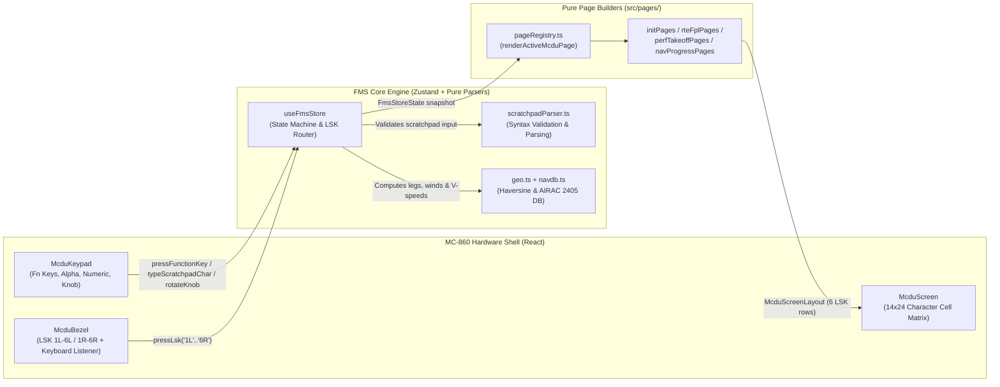

# Embraer E2 Honeywell NG FMS MCDU Simulator — Developer Architecture & Onboarding Guide

This document provides a comprehensive technical reference for software engineers and avionics simulation developers working on the **Embraer E190-E2 / E195-E2 Honeywell Next Generation (NG) FMS MCDU (MC-860)** simulator.

---

## 1. Project Overview & Domain Context

The simulator replicates the physical hardware bezel, 14×24 character LCD display, scratchpad entry grammar, flight-plan state machine, and performance/takeoff/landing computation engine of the **Honeywell Primus Epic 2 Next Generation Flight Management System (NG FMS)** installed on Embraer E-Jets E2 (`E190-E2` / `E195-E2`).

### Primary Reference Documents
All screen layouts, color conventions, LSK flows, and operational sequences are grounded in two official pilot references:
1. **Honeywell NG FMS for the Embraer E-Jet E2 (E190/E195-E2) Pilot's Guide — Section 4: Operational Example (REV 0, May 2024)** (`KPHX → KMSP`, Alternate `KDLH`)
2. **LATAM Guia Rápido: Preenchimento do FMS Embraer E195** (`SBGR → SBCF`, Alternate `SBGO`)

---

## 2. Technology Stack

| Layer | Technology | Purpose |
| :--- | :--- | :--- |
| **UI Framework** | React 19 + TypeScript 5.7 | Declarative component tree & strict compile-time type safety |
| **State Management** | Zustand 5 (`useFmsStore`) | Single-source-of-truth avionics state machine, LSK router & TOLD engine |
| **Styling** | Tailwind CSS v4 + Custom CSS Grid | Authentic MC-860 metallic bezel, tactile keys, and 14×24 LCD character grid |
| **Audio** | Web Audio API (`soundEngine.ts`) | Zero-dependency synthesized tactile key clicks and avionics alert chimes |
| **Build & Bundler** | Vite 6 | Fast HMR development server and optimized static production bundle |
| **Testing** | Vitest 3 | Unit & integration tests for parsers, geometry, page builders, and preflight flows |

---

## 3. High-Level Architecture & Data Flow

The simulator follows a strict **unidirectional avionics cycle**:



### Core Architectural Principles
1. **Pure Page Builders**: Files in `src/pages/` are **100% pure functions** `(state: FmsStoreState) => McduScreenLayout`. They never mutate state or trigger side effects; they only project the current store state into a 6-row LSK screen descriptor.
2. **Centralized State Transitions**: All mutations, scratchpad validations, `MOD` vs. `ACT` flight plan staging, and page transitions happen inside `src/store/useFmsStore.ts`.
3. **Strict 14×24 Character Grid**: The display never renders arbitrary free-flowing HTML inside the LCD. Every screen is compiled by `buildScreenGrid()` into an exact `14 rows × 24 columns` matrix of `McduCell` objects (`{ char, color, size, reverse }`).

---

## 4. Directory & Module Guide

```text
src/
├── App.tsx                         # Top-level layout: Flight Phase Bar, Mode Toggle, MCDU Bezel, Training & Telemetry Panels
├── index.css                       # MC-860 metallic bezel styles, 14x24 CSS Grid rules, tactile key styles
├── audio/
│   └── soundEngine.ts              # Web Audio API synthesizer (key clicks, error tones, alert chimes)
├── types/
│   └── fms.ts                      # Core TypeScript domain types (McduPageId, FmsFlightPlan, McduScreenLayout, etc.)
├── data/
│   └── navdb.ts                    # Static AIRAC 2405 navigation database (Airports, Runways, SIDs, STARs, Airways, Fixes)
├── utils/
│   └── geo.ts                      # Great-circle Haversine distance, initial bearing, and ARINC 424 Lat/Lon formatters
├── engine/
│   └── scratchpadParser.ts         # Pure syntax parsers for ZFW, CG, Altitudes, Speeds, Winds, Waypoints, and Holds
├── pages/
│   ├── pageRegistry.ts             # Central switch dispatcher mapping McduPageId -> page builder function
│   ├── initPages.ts                # RADIO, NAV INDEX 1/2-2/2, NAV IDENT, POS INIT, POS SENSORS, FMS MAINT
│   ├── rteFplPages.ts              # ACT/MOD RTE 1-3, DEPARTURE chain, ACTIVE FLT PLAN, HOLD, CUSTOM WPT
│   ├── perfTakeoffPages.ts         # PERF INIT 1/3-3/3, CRUISE MODES, T/O DATASET, TAKEOFF INIT/FLAPS/VSPEEDS, DEP LIM
│   └── navProgressPages.ts         # PROGRESS 1-3, ARRIVAL chain, LANDING INIT/ROAAS/LANDING, MISSED APPR, ALTN FPL, FIX, OFFSET
├── store/
│   └── useFmsStore.ts              # Unified Zustand store, scratchpad stack, LSK action handlers, TOLD calculator, presets
└── components/
    ├── mcdu/
    │   ├── McduBezel.tsx           # Metallic-grey frame, DZUS fasteners, green sensors, 14-row aligned LSK columns
    │   ├── McduKeypad.tsx          # 2-row Function Matrix, Left Square Alpha keys, Right Round Numeric keys, Rotary Knob
    │   └── McduScreen.tsx          # buildScreenGrid() compiler & 14x24 DOM cell renderer
    └── training/
        ├── GuidedPreflightPanel.tsx # 10-step interactive checklist, "Do Step" auto-runner & LATAM/Honeywell scenario presets
        └── InstructorDrawer.tsx     # Real-time FMS state inspector & 6 abnormal/fault scenario injectors
```

---

## 5. Deep Dive: The 14×24 Character LCD & LSK Alignment

### 5.1 Screen Row Mapping (`McduScreen.tsx`)
The Honeywell MC-860 screen has **14 horizontal text lines**, each **24 characters wide**:

| LCD Line (1-based) | Grid Array Index (`0..13`) | Purpose | Default Font Size & Color |
| :--- | :--- | :--- | :--- |
| **Line 1** | `grid[0]` | Centered Page Title + Right-aligned Page Index (`1/3`) | `LARGE WHITE` title (`CYAN` `MOD`, `GREEN` Airport ICAO), `SMALL WHITE` page number |
| **Line 2** | `grid[1]` | `rows[0]` Label Line (above `1L` / `1R`) | `SMALL WHITE` |
| **Line 3** | `grid[2]` | **`rows[0]` Data Line (`LSK 1L` / `LSK 1R`)** | `LARGE GREEN` / `CYAN` / `WHITE` |
| **Line 4** | `grid[3]` | `rows[1]` Label Line (above `2L` / `2R`) | `SMALL WHITE` |
| **Line 5** | `grid[4]` | **`rows[1]` Data Line (`LSK 2L` / `LSK 2R`)** | `LARGE GREEN` / `CYAN` / `WHITE` |
| **Line 6** | `grid[5]` | `rows[2]` Label Line (above `3L` / `3R`) | `SMALL WHITE` |
| **Line 7** | `grid[6]` | **`rows[2]` Data Line (`LSK 3L` / `LSK 3R`)** | `LARGE GREEN` / `CYAN` / `WHITE` |
| **Line 8** | `grid[7]` | `rows[3]` Label Line (above `4L` / `4R`) | `SMALL WHITE` |
| **Line 9** | `grid[8]` | **`rows[3]` Data Line (`LSK 4L` / `LSK 4R`)** | `LARGE GREEN` / `CYAN` / `WHITE` |
| **Line 10** | `grid[9]` | `rows[4]` Label Line (above `5L` / `5R`) | `SMALL WHITE` |
| **Line 11** | `grid[10]` | **`rows[4]` Data Line (`LSK 5L` / `LSK 5R`)** | `LARGE GREEN` / `CYAN` / `WHITE` |
| **Line 12** | `grid[11]` | `rows[5]` Label Line (above `6L` / `6R`) | `SMALL WHITE` |
| **Line 13** | `grid[12]` | **`rows[5]` Data Line (`LSK 6L` / `LSK 6R`)** | `LARGE WHITE` navigation prompts (`◄` / `►`) |
| **Line 14** | `grid[13]` | Scratchpad User Input or Reverse-Video Alert Message | `LARGE CYAN` (input) or `REVERSE WHITE` (alert) |

### 5.2 Pixel-Perfect LSK Button Alignment (`McduBezel.tsx`)
To ensure the physical `1L–6L` and `1R–6R` buttons always line up with their corresponding LCD data rows regardless of viewport scaling:
- Both the Left LSK column, the LCD Screen (`.mcdu-lcd-grid`), and the Right LSK column use `grid-template-rows: repeat(14, minmax(0, 1fr))` with matching `18px` vertical padding (`p-2` recess + `py-2.5` screen padding).
- Each LSK button is placed explicitly at `gridRow: 3 + idx * 2` (rows `3, 5, 7, 9, 11, 13`).
- The 5 horizontal metallic divider ticks are placed at `gridRow: 2 + idx * 2` (rows `4, 6, 8, 10, 12`).

---

## 6. Deep Dive: State Machine & Key Workflows (`useFmsStore.ts`)

### 6.1 Scratchpad & Priority Alert Queue
- **User Typing (`scratchpadInput`)**: Typing alphanumeric keys appends characters up to 22 characters.
- **Delete Mode (`deleteMode`)**: Pressing the `DEL` key sets `scratchpadInput = 'DELETE'` and `deleteMode = true`. Subsequent LSK presses check `state.deleteMode` to clear optional fields or remove flight plan waypoints/discontinuities.
- **Priority Message Stack (`messages: ScratchpadMessage[]`)**:
  - Alerts are ranked by priority: `HIGH` (3) > `MEDIUM` (2) > `LOW` (1), then by newest timestamp.
  - When `messages.length > 0`, the top message overrides Line 14 in reverse video and illuminates the `MSG` annunciator.
  - Pressing `CLR` pops the top alert message first; when no messages remain, `CLR` deletes the last character of `scratchpadInput` (or clears `*DELETE*`).

### 6.2 Active (`ACT`) vs. Modified (`MOD`) Flight Plan Lifecycle
Whenever the pilot edits the route (e.g., changing Origin/Dest, selecting a Departure Runway/SID, inserting a waypoint, deleting a discontinuity, or selecting an Arrival STAR/Approach):
1. If `modFlightPlan` is `null`, the store clones `flightPlan` into `modFlightPlan` with `planType: 'MOD'`.
2. Page headers automatically switch from `ACT RTE` / `ACTIVE FLT PLAN` to `MOD RTE` (with `MOD` in cyan) / `MOD FLT PLAN`.
3. Row 6 prompts switch to `6L <CANCEL` and `6R ACTIVATE>`.
4. Pressing `6L (<CANCEL)` discards `modFlightPlan` (`modFlightPlan: null`).
5. Pressing `6R (ACTIVATE>)` promotes `modFlightPlan` to `flightPlan` (`planType: 'ACTIVE'`), recomputes leg distances/ETAs/EFOB via `computeFlightPlanPredictions()`, and clears `modFlightPlan`.

### 6.3 Multi-Screen Procedure Staging (`pendingDeparture` & `pendingArrival`)
- **Departure Selection (`DEPARTURE` → `DEPARTURE_RUNWAYS` → `DEPARTURE_SIDS` → `DEPARTURE_TRANS` → `DEPARTURE`)**:
  - Selections are staged in `state.pendingDeparture` (`{ runway, sid, transition }`).
  - Pressing `6R (APPLY>)` on `DEPARTURE 1/1` commits the staged runway and SID waypoints into `modFlightPlan` and transitions to `MOD RTE 2/3`.
- **Arrival Selection (`ARRIVAL` → `ARRIVAL_RUNWAYS` → `ARRIVAL_STARS` → `ARRIVAL_STAR_TRANS` → `ARRIVAL_APPROACH` → `ARRIVAL_APPR_TRANS` → `ARRIVAL`)**:
  - Selections are staged in `state.pendingArrival`.
  - Pressing `6R (APPLY>)` commits the STAR and Approach into `modFlightPlan` and returns to `MOD FLT PLAN`.

### 6.4 Weight Unit Dual-Support (`KG` & Thousands)
- Internally, `state.weights` stores weights in **thousands of kilograms** (e.g. `40.0` = `40,000 KG`, `14.2` = `14,200 KG`) for compact fuel burn math, while `parseZfwInput()` and `PERFORMANCE INIT-KG 2/3` accept and display **both** full kilograms (`40000`) and decimal thousands (`40.0`).

---

## 7. Developer Recipes: How to Extend the Simulator

### 7.1 How to Add a New MCDU Page
1. **Register the Page ID**:
   Add the new page identifier to the `McduPageId` union in [`src/types/fms.ts`](file:///d:/leandro/DEV/remote-repos/e2_fms/src/types/fms.ts).
2. **Write the Pure Page Builder**:
   In the appropriate file under `src/pages/` (e.g. [`initPages.ts`](file:///d:/leandro/DEV/remote-repos/e2_fms/src/pages/initPages.ts) or [`navProgressPages.ts`](file:///d:/leandro/DEV/remote-repos/e2_fms/src/pages/navProgressPages.ts)), create a function returning a `McduScreenLayout` with a 6-element `rows` tuple:
   ```ts
   export function renderMyNewPage(state: FmsStoreState): McduScreenLayout {
     return {
       title: 'MY NEW PAGE',
       pageNumber: '1/1',
       rows: [
         { labelLeft: 'FIELD 1', left: 'VALUE 1', leftColor: 'GREEN' },
         {},
         {},
         {},
         {},
         { left: '<RETURN', leftColor: 'WHITE' },
       ],
     };
   }
   ```
3. **Wire the Page into the Dispatcher**:
   Add a `case 'MY_NEW_PAGE': return renderMyNewPage(state);` branch in [`src/pages/pageRegistry.ts`](file:///d:/leandro/DEV/remote-repos/e2_fms/src/pages/pageRegistry.ts).
4. **Handle LSK Presses & Sub-Page Pagination**:
   In [`src/store/useFmsStore.ts`](file:///d:/leandro/DEV/remote-repos/e2_fms/src/store/useFmsStore.ts):
   - If the page has multiple sub-pages (`1/2`, `2/2`), add its max page count to `getMaxSubPages()` inside `pressFunctionKey` (`NEXT` / `PREV`).
   - Add an `if (state.activePage === 'MY_NEW_PAGE') { ... }` block inside `pressLsk()` to handle `1L–6L` and `1R–6R` clicks.

### 7.2 How to Add New Airports, Procedures, or Airways
Open [`src/data/navdb.ts`](file:///d:/leandro/DEV/remote-repos/e2_fms/src/data/navdb.ts):
- **Fixes / Waypoints**: Add entries to `NAV_FIXES` with `{ ident, name, lat, lon, type }`.
- **Airports**: Add entries to `NAV_AIRPORTS` with `{ icao, name, lat, lon, elevationFt, referenceWaypoint, runways, sids, stars, approaches }`.
- **Airways**: Add entries to `NAV_AIRWAYS` with `{ ident, fixes: ['FIX1', 'FIX2', ...] }`.
- **Company Routes**: Add entries to `NAV_COMPANY_ROUTES`.

---

## 8. Testing & Verification Strategy

The project maintains a fast, deterministic Vitest suite covering all layers of the architecture:

| Test Suite | File | What It Verifies |
| :--- | :--- | :--- |
| **LCD Grid Builder** | `src/components/mcdu/__tests__/McduScreen.test.ts` | 14×24 matrix dimensions, `□` box prompt styling, reverse-video scratchpad alerts |
| **Scratchpad Parsers** | `src/engine/__tests__/scratchpadParser.test.ts` | ZFW, CG envelope (`15%–36%`), Alt/Speed constraints, Wind, Custom Waypoints (`Lat/Lon`, `PBD`, `PBPB`) |
| **Geodesic Math** | `src/utils/__tests__/geo.test.ts` | Haversine distance, bearing, PBD projection, ARINC 424 coordinate formatting |
| **Core FMS Store** | `src/store/__tests__/useFmsStore.test.ts` | Scratchpad typing, `DEL`/`CLR` priority alert queue, LSK routing |
| **Init Pages** | `src/pages/__tests__/initPages.test.ts` | `RADIO 1/1`, `NAV INDEX 1/2–2/2`, `NAV IDENT 1/1`, `POSITION INIT 1/1` |
| **Route & FPL Pages** | `src/pages/__tests__/rteFplPages.test.ts` | `ACT/MOD RTE`, multi-screen `DEPARTURE` (`RUNWAYS -> SIDS -> APPLY>`), 2-step `VIA/TO` airways |
| **Perf & Takeoff Pages** | `src/pages/__tests__/perfTakeoffPages.test.ts` | `PERF INIT-KG 1/3–3/3`, `T/O DATASET MENU` + Rotary Knob, `TAKEOFF INIT` winds, `DEPARTURE LIMIT` |
| **Nav & Progress Pages** | `src/pages/__tests__/navProgressPages.test.ts` | Flight-phase dynamic `ACTIVE FLT PLAN`, `ARRIVAL` chain, `LANDING INIT -> ROAAS -> LANDING` |
| **Guided Preflight & QA** | `src/components/training/__tests__/guidedPreflight.test.ts` | Full 10-step Cold-to-Ready preflight flow, `LATAM` & `Honeywell` scenario presets, fault recovery |

### Running Verification Commands
```bash
# Run all unit and integration tests
npx vitest run

# Run TypeScript compiler check and Vite production bundle build
npm run build
```
